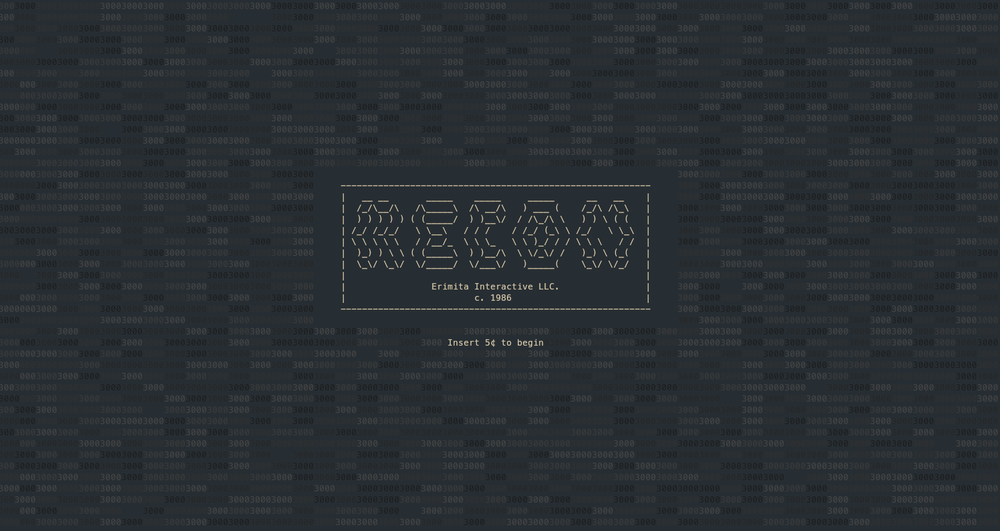

# recon-1986-emulator-v3

(A game made for [Terra](https://terra.hackclub.com/))

Version 3.4 of the community emulator for the 1986 arcade game, *Recon* by Eremita Interactive LLC. This emulator is not officially licensed by Eremita Interactive LLC. or parent companies.

## About
This is mostly the shell of a game as I didn't have time (or motivation) to turn this into a full game.
I have:
- Maps and movement
- Cool TUI title screen
- Interactive objects

## How and why I made this
I made this in Rust using `ncurses`
This week's Terra theme was "Retro" and my first thought was something terminal based and inspired by the original 1980s title "Rogue".

## Installation
### Linux / MacOS
Simply install the binary from the release
### Windows
You'll have to compile it yourself, good luck!

## Inspiration

- Story: Majorly inspired by [SCP-3000](https://scp-wiki.wikidot.com/scp-3000)
- Vibes: Based off [PROXIMATE](https://store.steampowered.com/app/2957800/PROXIMATE/) and [Iron Lung](https://store.steampowered.com/app/1846170/Iron_Lung/) (Neither of which I have played but I know the vibes)
- Visuals: The original [Rogue](https://store.steampowered.com/app/1443430/Rogue/) which is why I'm calling this a Roguelike (I'm very funny, see)
